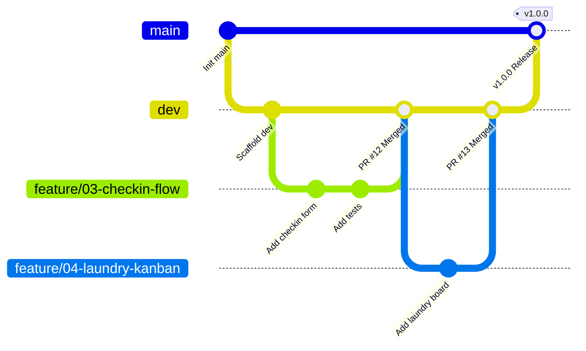

# Development Standards, Git Workflow & Component Guidelines

All engineers contributing to the **Enku Hotel Management SaaS** must follow this document to ensure clean branch merges, reusable design system adherence, and code quality.

---

## 🌿 1. Git Workflow & Branching Strategy

The repository maintains two permanent branches:
* **`main`**: Protected production branch. Deployed to production environments only. Never commit or push directly to `main`.
* **`dev`**: Active integration & staging branch. **All feature branches branch off `dev` and pull requests must target `dev`**.



### 1.1 Branch Naming Conventions
Always create your branch from the latest `dev`:
```bash
git checkout dev
git pull origin dev
git checkout -b <branch-type>/<module-number>-<short-description>
```

| Branch Type | Format | Example |
| :--- | :--- | :--- |
| **New Feature** | `feature/{module-number}-{kebab-case}` | `feature/04-laundry-intake-form`<br>`feature/03-checkin-modal` |
| **Bug Fix** | `bugfix/{module-number}-{issue-summary}` | `bugfix/02-room-grid-duplicate-keys` |
| **Performance** | `perf/{module-number}-{area}` | `perf/07-night-audit-query-optimization` |
| **Urgent Hotfix** | `hotfix/{critical-patch}` | `hotfix/csrf-session-timeout` |

### 1.2 Pull Request (PR) Requirements
Before opening a PR into `dev`:
1. **Run PHP Formatter:**
   ```bash
   vendor/bin/pint --format agent
   ```
2. **Run Tests:**
   ```bash
   php artisan test
   ```
3. **Verify Frontend Build & Types:**
   ```bash
   npm run build
   ```
4. **PR Description:**
   * Reference the corresponding module file and task number (e.g. `Fixes Task 4.2 in docs/04-laundry-valet-service.md`).
   * Include screenshots for UI changes.

---

## 🎨 2. Enqu Design System & Brand Palette

The project uses the official **Enqu (@enqujob)** brand palette configured directly in `tailwind.config.js`:

| Token | Class Name | Hex Code | Visual Usage |
| :--- | :--- | :--- | :--- |
| **Primary (Brand Teal)** | `bg-primary-800` / `text-primary-800` | `#004758` | Main action buttons, active navigation, brand headers |
| **Primary Vibrant** | `bg-primary-500` / `text-primary-500` | `#0ea5a4` | Focus rings, interactive highlights, status accents |
| **Accent (Warm Gold)** | `bg-accent-500` / `text-accent-500` | `#f59e0b` | Express tags, VIP badges, prominent warnings |
| **Dark Canvas** | `bg-enquDark-900` | `#0f171c` | Sidebar dark mode, high-contrast containers |

---

## 🧩 3. Reusable Component Library (`@/Components/ui`)

Do **not** recreate raw buttons, cards, badges, or inputs. Always import pre-built components from `@/Components/ui`:

```typescript
import {
    Button,
    Badge,
    Card,
    CardHeader,
    CardTitle,
    CardContent,
    StatCard,
    PageHeader,
    Input,
    Select,
    Table,
    TableHeader,
    TableBody,
    TableRow,
    TableHead,
    TableCell,
    EmptyState,
} from '@/Components/ui';
```

### 3.1 Button Component
```tsx
<Button variant="primary" size="md" leftIcon={<Key className="w-4 h-4" />}>
    Check In Guest
</Button>

<Button variant="accent" size="sm">
    Express Wash (+50%)
</Button>

<Button variant="outline" size="sm" isLoading={isSubmitting}>
    Save Draft
</Button>
```
* **Variants:** `'primary' | 'accent' | 'secondary' | 'outline' | 'danger' | 'ghost'`
* **Sizes:** `'xs' | 'sm' | 'md' | 'lg'`

### 3.2 Status Badge Component
```tsx
<Badge variant="success" dot>Vacant Clean</Badge>
<Badge variant="warning" dot>Cleaning In Progress</Badge>
<Badge variant="danger" dot>Out of Order</Badge>
<Badge variant="primary" dot>Occupied</Badge>
```
* **Variants:** `'success' | 'warning' | 'danger' | 'info' | 'primary' | 'accent' | 'neutral'`

### 3.3 Stat Card Component (KPIs)
```tsx
<StatCard
    title="Today's Occupancy"
    value="84.5%"
    change={5.2}
    subtitle="vs yesterday"
    icon={<Bed className="w-5 h-5" />}
/>
```

### 3.4 Page Header Component
```tsx
<PageHeader
    title="Laundry Operations"
    subtitle="Track in-house linen and guest valet laundry cycles"
    breadcrumbs={[
        { label: 'Dashboard', href: '/dashboard' },
        { label: 'Laundry' },
    ]}
    actions={
        <Button variant="primary" leftIcon={<Plus className="w-4 h-4" />}>
            New Order Intake
        </Button>
    }
/>
```

### 3.5 Input & Select Components
```tsx
<Input
    label="Guest Passport Number"
    required
    placeholder="e.g. A12345678"
    error={errors.id_number}
    value={data.id_number}
    onChange={(e) => setData('id_number', e.target.value)}
/>

<Select
    label="Select Room"
    required
    options={availableRooms.map(r => ({ value: r.id, label: `Room ${r.room_number}` }))}
    error={errors.room_id}
/>
```

---

## 🏛️ 4. Backend Architecture & Coding Conventions

### 4.1 Multi-Tenant Scoping
Every model belonging to a hotel **must** use the `BelongsToHotel` trait:
```php
namespace App\Models;

use App\Traits\BelongsToHotel;
use Illuminate\Database\Eloquent\Model;

class LaundryOrder extends Model
{
    use BelongsToHotel;
    
    // Automatically adds WHERE hotel_id = session('active_hotel_id')
    // Automatically sets hotel_id upon creation
}
```

### 4.2 Standard Enums
Always use the strongly typed PHP enums in `app/Enums/`:
* `RoomStatus::VacantClean`
* `ReservationStatus::CheckedIn`
* `LaundryOrderStatus::InWash`
Each enum includes `->label()` and `->badgeVariant()` methods for instant frontend badge alignment.
