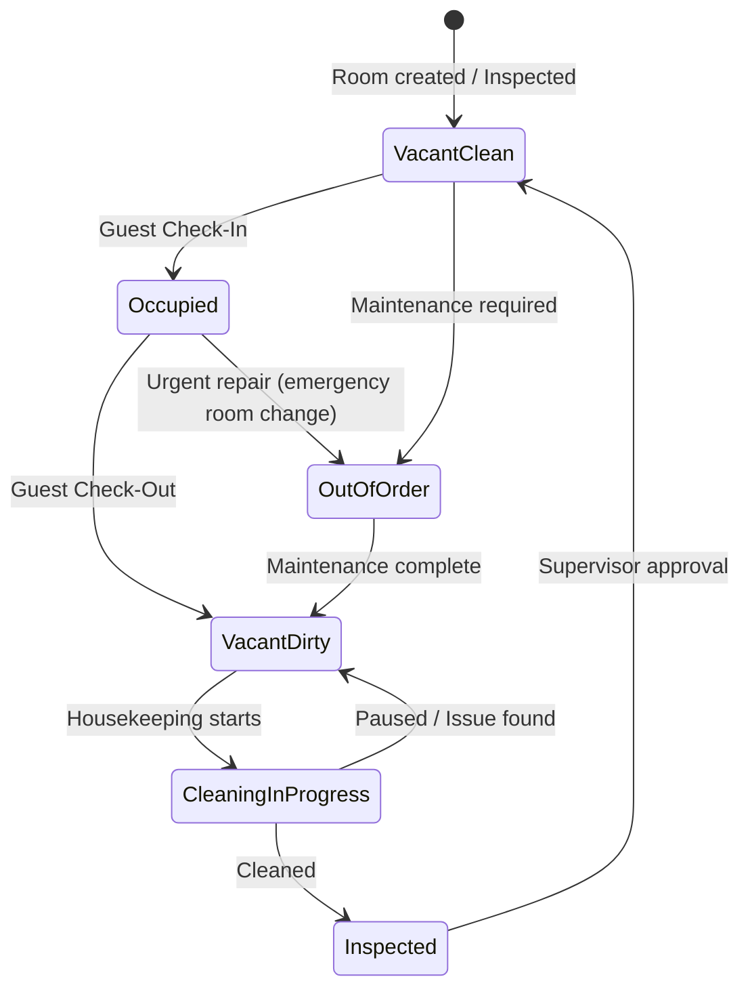

# Module 02: Property, Room Inventory & Rate Management

## 1. Overview & Objective
This module manages the physical infrastructure of the hotel: floors, room categories, individual rooms, amenities, and dynamic pricing rates. It provides the live room inventory engine that feeds into reservations, housekeeping, and front-desk check-in/out.

---

## 2. Room Lifecycle State Machine



---

## 3. Database Schema

### Table: `room_types`
```sql
CREATE TABLE `room_types` (
    `id` BIGINT UNSIGNED AUTO_INCREMENT PRIMARY KEY,
    `hotel_id` BIGINT UNSIGNED NOT NULL,
    `name` VARCHAR(100) NOT NULL,
    `slug` VARCHAR(100) NOT NULL,
    `description` TEXT NULL,
    `base_occupancy` INT UNSIGNED DEFAULT 2,
    `max_occupancy` INT UNSIGNED DEFAULT 4,
    `base_price` DECIMAL(10, 2) NOT NULL,
    `extra_person_fee` DECIMAL(10, 2) DEFAULT 0.00,
    `amenities` JSON NULL, -- e.g. ["Wi-Fi", "Mini Bar", "Sea View", "Jacuzzi"]
    `created_at` TIMESTAMP NULL,
    `updated_at` TIMESTAMP NULL,
    FOREIGN KEY (`hotel_id`) REFERENCES `hotels`(`id`) ON DELETE CASCADE
);
```

### Table: `rooms`
```sql
CREATE TABLE `rooms` (
    `id` BIGINT UNSIGNED AUTO_INCREMENT PRIMARY KEY,
    `hotel_id` BIGINT UNSIGNED NOT NULL,
    `room_type_id` BIGINT UNSIGNED NOT NULL,
    `room_number` VARCHAR(50) NOT NULL,
    `floor_number` INT NOT NULL,
    `status` ENUM('vacant_clean', 'vacant_dirty', 'occupied', 'cleaning', 'out_of_order') DEFAULT 'vacant_clean',
    `is_active` BOOLEAN DEFAULT TRUE,
    `notes` TEXT NULL,
    `created_at` TIMESTAMP NULL,
    `updated_at` TIMESTAMP NULL,
    FOREIGN KEY (`hotel_id`) REFERENCES `hotels`(`id`) ON DELETE CASCADE,
    FOREIGN KEY (`room_type_id`) REFERENCES `room_types`(`id`) ON DELETE RESTRICT,
    UNIQUE KEY `hotel_room_number_unique` (`hotel_id`, `room_number`)
);
```

### Table: `rate_plans` & `room_rates`
```sql
CREATE TABLE `room_rates` (
    `id` BIGINT UNSIGNED AUTO_INCREMENT PRIMARY KEY,
    `hotel_id` BIGINT UNSIGNED NOT NULL,
    `room_type_id` BIGINT UNSIGNED NOT NULL,
    `rate_name` VARCHAR(100) NOT NULL, -- e.g. "Weekend Surcharge", "Peak Season"
    `start_date` DATE NOT NULL,
    `end_date` DATE NOT NULL,
    `price_per_night` DECIMAL(10, 2) NOT NULL,
    `is_active` BOOLEAN DEFAULT TRUE,
    `created_at` TIMESTAMP NULL,
    `updated_at` TIMESTAMP NULL,
    FOREIGN KEY (`hotel_id`) REFERENCES `hotels`(`id`) ON DELETE CASCADE,
    FOREIGN KEY (`room_type_id`) REFERENCES `room_types`(`id`) ON DELETE CASCADE
);
```

---

## 4. Backend Implementation Specification

### Key Models:
* `App\Models\RoomType`: Relationships `hasMany(Room::class)`, `hasMany(RoomRate::class)`.
* `App\Models\Room`: Methods `markAsClean()`, `markAsDirty()`, `setOccupied()`, `setOutOfOrder()`.
* `App\Services\PricingService`: Calculates effective daily room rate given date, day-of-week, and active seasonal rules.

### Controllers & Routes:
* `RoomTypeController`: Resource CRUD for categories.
* `RoomController`: List with floor & status filters, bulk room creation (e.g. Floor 1 Rooms 101-120).
* `RoomStatusController`: Endpoint `PATCH /rooms/{id}/status` to quickly toggle status with validation.

---

## 5. Frontend (React + TypeScript) Specification

### Components & Views:
* `resources/js/Pages/Rooms/Index.tsx`: Visual interactive floor-by-floor Room Grid:
  * Badges for statuses (Green = *Vacant Clean*, Amber = *Vacant Dirty*, Blue = *Occupied*, Red = *Out of Order*).
  * Filter by floor, room type, and status.
  * Quick modal action on click: View details, change status, assign room.
* `resources/js/Pages/Rooms/Create.tsx`: Single room creation or batch room generator (prefix, start number, end number, floor).
* `resources/js/Pages/RoomTypes/Index.tsx`: Manage categories, base rates, and photo/amenity tags.
* `resources/js/Pages/Rates/Index.tsx`: Calendar rate override manager.

---

## 6. Developer Task Checklist

- [ ] **Task 2.1:** Create migrations for `room_types`, `rooms`, and `room_rates`.
- [ ] **Task 2.2:** Create Eloquent Models with `BelongsToHotel` trait, casts, and relationship methods.
- [ ] **Task 2.3:** Implement batch room creation service (`BulkRoomCreateRequest`: start_num, end_num, floor, type).
- [ ] **Task 2.4:** Build `PricingService` with unit tests covering base price, weekend overrides, and holiday seasons.
- [ ] **Task 2.5:** Create the React Visual Room Grid component with color-coded status badges and quick action popups.
- [ ] **Task 2.6:** Add filter bar (search room #, filter by floor, filter by status, filter by room type).
- [ ] **Task 2.7:** Write feature tests for room status transitions (prevent invalid state hops, e.g. clean to clean).

---

## 7. QA Acceptance Criteria
1. Duplicate room numbers within the same hotel are strictly rejected with a clear validation error.
2. Pricing engine always calculates the exact effective price for any given stay date range.
3. The visual grid renders efficiently even with 200+ rooms across multiple floors without layout shifts.
