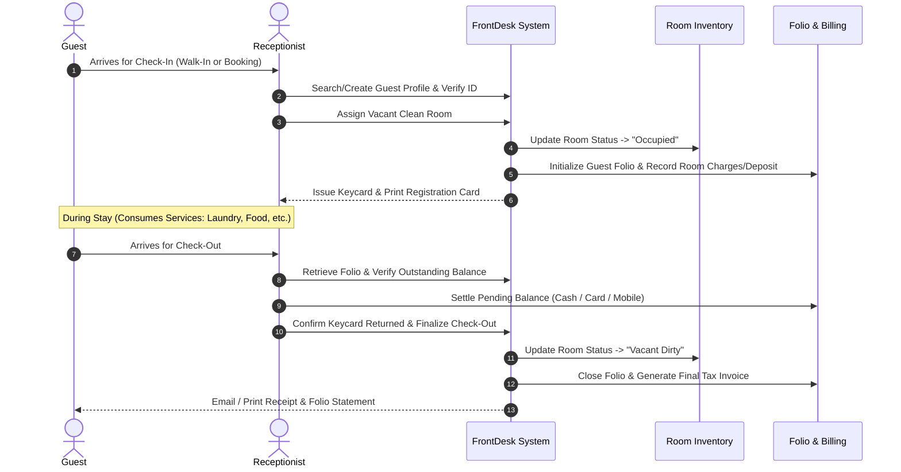

# Module 03: Guest CRM & Front Desk Operations (Check-In & Check-Out)

## 1. Overview & Objective
This module serves as the operational heart of front-desk reception. It manages the complete lifecycle of hotel guests: guest identity profiles, advance bookings/reservations, walk-in registrations, seamless room check-in, keycard management, and check-out folio settlement.

---

## 2. Check-In & Check-Out Operational Flow



---

## 3. Database Schema

### Table: `guests`
```sql
CREATE TABLE `guests` (
    `id` BIGINT UNSIGNED AUTO_INCREMENT PRIMARY KEY,
    `hotel_id` BIGINT UNSIGNED NOT NULL,
    `first_name` VARCHAR(100) NOT NULL,
    `last_name` VARCHAR(100) NOT NULL,
    `email` VARCHAR(255) NULL,
    `phone` VARCHAR(50) NOT NULL,
    `id_type` ENUM('passport', 'national_id', 'drivers_license', 'other') NOT NULL,
    `id_number` VARCHAR(100) NOT NULL,
    `nationality` VARCHAR(100) DEFAULT 'Unknown',
    `car_plate_number` VARCHAR(50) NULL,
    `vip_level` ENUM('standard', 'silver', 'gold', 'vip') DEFAULT 'standard',
    `is_blacklisted` BOOLEAN DEFAULT FALSE,
    `blacklist_reason` TEXT NULL,
    `total_stays_count` INT UNSIGNED DEFAULT 0,
    `special_preferences` TEXT NULL, -- e.g. "High floor, extra pillow"
    `created_at` TIMESTAMP NULL,
    `updated_at` TIMESTAMP NULL,
    FOREIGN KEY (`hotel_id`) REFERENCES `hotels`(`id`) ON DELETE CASCADE,
    INDEX `guest_search_idx` (`hotel_id`, `phone`, `email`, `id_number`)
);
```

### Table: `reservations`
```sql
CREATE TABLE `reservations` (
    `id` BIGINT UNSIGNED AUTO_INCREMENT PRIMARY KEY,
    `hotel_id` BIGINT UNSIGNED NOT NULL,
    `reservation_code` VARCHAR(20) NOT NULL UNIQUE, -- e.g. "ENK-2026-8941"
    `guest_id` BIGINT UNSIGNED NOT NULL,
    `room_id` BIGINT UNSIGNED NULL, -- May be unallocated until check-in
    `room_type_id` BIGINT UNSIGNED NOT NULL,
    `check_in_date` DATE NOT NULL,
    `check_out_date` DATE NOT NULL,
    `actual_check_in_at` TIMESTAMP NULL,
    `actual_check_out_at` TIMESTAMP NULL,
    `adults_count` INT UNSIGNED DEFAULT 1,
    `children_count` INT UNSIGNED DEFAULT 0,
    `daily_rate` DECIMAL(10, 2) NOT NULL,
    `total_amount` DECIMAL(10, 2) NOT NULL,
    `advance_deposit_paid` DECIMAL(10, 2) DEFAULT 0.00,
    `keycard_number` VARCHAR(50) NULL,
    `status` ENUM('confirmed', 'checked_in', 'checked_out', 'cancelled', 'no_show') DEFAULT 'confirmed',
    `source` ENUM('walk_in', 'phone', 'website', 'ota_booking') DEFAULT 'walk_in',
    `cancellation_reason` TEXT NULL,
    `created_at` TIMESTAMP NULL,
    `updated_at` TIMESTAMP NULL,
    FOREIGN KEY (`hotel_id`) REFERENCES `hotels`(`id`) ON DELETE CASCADE,
    FOREIGN KEY (`guest_id`) REFERENCES `guests`(`id`) ON DELETE RESTRICT,
    FOREIGN KEY (`room_id`) REFERENCES `rooms`(`id`) ON DELETE SET NULL,
    FOREIGN KEY (`room_type_id`) REFERENCES `room_types`(`id`) ON DELETE RESTRICT
);
```

---

## 4. Backend Implementation Specification

### Actions & Services:
* `App\Services\CheckInService`:
  * Validates that the selected room is `vacant_clean`.
  * Verifies guest is not blacklisted (or halts with override prompt).
  * Updates room status to `occupied`.
  * Initializes guest folio in `FolioService`.
  * Sets reservation status to `checked_in`.
* `App\Services\CheckOutService`:
  * Inspects active folio for unbilled balance.
  * Validates payment receipt if balance > 0.
  * Sets room status to `vacant_dirty`.
  * Increments guest's `total_stays_count`.
  * Dispatches event `GuestCheckedOutEvent` (notifies housekeeping queue).

### Key Endpoints:
* `POST /reservations`: Create advance booking.
* `POST /check-in`: Process walk-in or reservation check-in.
* `POST /check-out/{reservationId}`: Process checkout and bill settlement.
* `GET /guests/search?query=...`: Real-time autocomplete for returning guests.

---

## 5. Frontend (React + TypeScript) Specification

### Pages & Components:
* `resources/js/Pages/FrontDesk/Dashboard.tsx`: Front desk live command center:
  * Today's Expected Arrivals, Today's Expected Departures, Stays in House.
  * Quick Check-In and Walk-In action triggers.
* `resources/js/Pages/FrontDesk/CheckInModal.tsx`:
  * Step 1: Guest lookup or new registration form.
  * Step 2: Room picker (filtered strictly by `vacant_clean` rooms of chosen type).
  * Step 3: Keycard assignment, advance deposit input, registration summary.
* `resources/js/Pages/FrontDesk/CheckOutModal.tsx`:
  * Real-time itemized folio breakdown.
  * Settle balance prompt (Cash, Card, Transfer).
  * Keycard return confirmation checkbox.
  * 1-Click "Complete Check-Out & Print Invoice".
* `resources/js/Pages/Guests/Index.tsx`: Guest directory with visit history, spending metrics, and VIP badges.

---

## 6. Developer Task Checklist

- [ ] **Task 3.1:** Create database migrations for `guests` and `reservations` tables with appropriate indexes.
- [ ] **Task 3.2:** Build `Guest` and `Reservation` Eloquent models with relationship scopes.
- [ ] **Task 3.3:** Implement `CheckInService` with strict validation that prevents checking into dirty or occupied rooms.
- [ ] **Task 3.4:** Implement `CheckOutService` verifying folio balance settlement before finalizing status.
- [ ] **Task 3.5:** Create Front Desk Dashboard view with today's arrivals/departures tabs and KPIs.
- [ ] **Task 3.6:** Build reusable Guest Autocomplete Search component in React with keyboard navigation.
- [ ] **Task 3.7:** Implement Check-In Wizard modal with room allocation and keycard input.
- [ ] **Task 3.8:** Implement Check-Out Folio Summary modal with instant print/download PDF button.
- [ ] **Task 3.9:** Write automated feature tests for walk-in check-in, reservation check-in, and checkout folio verification.

---

## 7. QA Acceptance Criteria
1. System strictly refuses check-in if the assigned room is `vacant_dirty`, `cleaning`, or `out_of_order`.
2. Blacklisted guests trigger a high-visibility warning banner requiring manager authorization.
3. Checking out a guest automatically flips the assigned room to `vacant_dirty` in the room inventory.
4. Reservation codes are unique and follow a predictable alphanumeric format.
