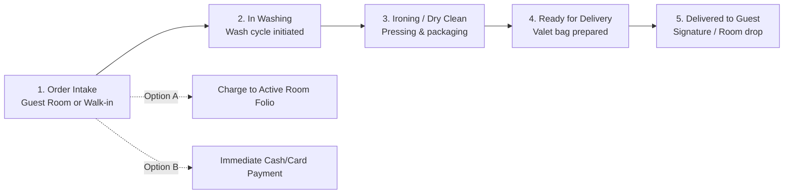

# Module 04: Laundry & Valet Services Module

## 1. Overview & Objective
Hotels provide both **Guest Personal Laundry** (valet service) and **In-House Hotel Linen Laundering** (housekeeping sheets, towels, restaurant tablecloths). This module manages laundry service pricing, order intake, multi-stage processing tracking, express service surcharges, direct guest folio posting, and in-house linen wash cycles.

---

## 2. Laundry Order Processing Lifecycle



---

## 3. Database Schema

### Table: `laundry_services` (Catalog & Pricing)
```sql
CREATE TABLE `laundry_services` (
    `id` BIGINT UNSIGNED AUTO_INCREMENT PRIMARY KEY,
    `hotel_id` BIGINT UNSIGNED NOT NULL,
    `item_name` VARCHAR(100) NOT NULL, -- e.g. "Men's Shirt", "Suit (2-Piece)", "Bedsheet (King)"
    `category` ENUM('apparel', 'delicate', 'linen', 'uniform') DEFAULT 'apparel',
    `service_type` ENUM('wash_and_iron', 'iron_only', 'dry_clean') DEFAULT 'wash_and_iron',
    `standard_price` DECIMAL(10, 2) NOT NULL,
    `express_price` DECIMAL(10, 2) NOT NULL, -- e.g. 50% surcharge for 2-hour express
    `is_active` BOOLEAN DEFAULT TRUE,
    `created_at` TIMESTAMP NULL,
    `updated_at` TIMESTAMP NULL,
    FOREIGN KEY (`hotel_id`) REFERENCES `hotels`(`id`) ON DELETE CASCADE
);
```

### Table: `laundry_orders`
```sql
CREATE TABLE `laundry_orders` (
    `id` BIGINT UNSIGNED AUTO_INCREMENT PRIMARY KEY,
    `hotel_id` BIGINT UNSIGNED NOT NULL,
    `order_number` VARCHAR(30) NOT NULL UNIQUE, -- e.g. "LND-2026-0042"
    `reservation_id` BIGINT UNSIGNED NULL, -- Null if walk-in customer
    `guest_id` BIGINT UNSIGNED NULL,
    `room_id` BIGINT UNSIGNED NULL,
    `order_type` ENUM('guest_valet', 'in_house_linen', 'walk_in') DEFAULT 'guest_valet',
    `is_express` BOOLEAN DEFAULT FALSE,
    `status` ENUM('received', 'in_wash', 'ironing', 'ready', 'delivered', 'cancelled') DEFAULT 'received',
    `payment_method` ENUM('charge_to_room', 'cash', 'card', 'unpaid') DEFAULT 'charge_to_room',
    `total_amount` DECIMAL(10, 2) NOT NULL DEFAULT 0.00,
    `special_instructions` TEXT NULL, -- e.g. "No starch, cold water only"
    `received_at` TIMESTAMP NOT NULL DEFAULT CURRENT_TIMESTAMP,
    `delivered_at` TIMESTAMP NULL,
    `processed_by_user_id` BIGINT UNSIGNED NOT NULL,
    `created_at` TIMESTAMP NULL,
    `updated_at` TIMESTAMP NULL,
    FOREIGN KEY (`hotel_id`) REFERENCES `hotels`(`id`) ON DELETE CASCADE,
    FOREIGN KEY (`reservation_id`) REFERENCES `reservations`(`id`) ON DELETE SET NULL,
    FOREIGN KEY (`guest_id`) REFERENCES `guests`(`id`) ON DELETE SET NULL,
    FOREIGN KEY (`room_id`) REFERENCES `rooms`(`id`) ON DELETE SET NULL,
    FOREIGN KEY (`processed_by_user_id`) REFERENCES `users`(`id`)
);
```

### Table: `laundry_order_items`
```sql
CREATE TABLE `laundry_order_items` (
    `id` BIGINT UNSIGNED AUTO_INCREMENT PRIMARY KEY,
    `laundry_order_id` BIGINT UNSIGNED NOT NULL,
    `laundry_service_id` BIGINT UNSIGNED NOT NULL,
    `quantity` INT UNSIGNED NOT NULL DEFAULT 1,
    `unit_price` DECIMAL(10, 2) NOT NULL,
    `subtotal` DECIMAL(10, 2) NOT NULL,
    `notes` VARCHAR(255) NULL, -- e.g. "Small stain on right collar"
    `created_at` TIMESTAMP NULL,
    `updated_at` TIMESTAMP NULL,
    FOREIGN KEY (`laundry_order_id`) REFERENCES `laundry_orders`(`id`) ON DELETE CASCADE,
    FOREIGN KEY (`laundry_service_id`) REFERENCES `laundry_services`(`id`) ON DELETE RESTRICT
);
```

---

## 4. Backend Implementation Specification

### Actions & Services:
* `App\Services\LaundryService`:
  * `createOrder(array $data)`: Calculates total, applies express rate if requested, generates unique `order_number`.
  * `updateStatus(LaundryOrder $order, string $newStatus)`: Validates transition sequence and logs staff timestamp.
  * `postToFolio(LaundryOrder $order)`: If `payment_method === 'charge_to_room'`, calls `FolioService::addCharge()` to append the bill to the active reservation folio.

### Key Endpoints:
* `GET /laundry/services`: List services and catalog prices.
* `POST /laundry/orders`: Create new laundry order intake.
* `PATCH /laundry/orders/{id}/status`: Advance pipeline status (*In Wash* $\rightarrow$ *Ironing* $\rightarrow$ *Ready* $\rightarrow$ *Delivered*).
* `POST /laundry/orders/{id}/post-charge`: Post laundry bill to room folio.
* `GET /laundry/orders/{id}/print-tag`: Generates printable thermal garment tag / receipt.

---

## 5. Frontend (React + TypeScript) Specification

### Pages & Views:
* `resources/js/Pages/Laundry/Index.tsx`: Operational Kanban Board / Tabbed Table:
  * Columns: **Received** $\rightarrow$ **In Wash** $\rightarrow$ **Ironing** $\rightarrow$ **Ready for Delivery** $\rightarrow$ **Delivered**.
  * Color-coded Express tags (Red pulse for `< 2h remaining`).
  * One-click action button on cards to advance to next stage.
* `resources/js/Pages/Laundry/Create.tsx`: Fast Order Intake Form:
  * Room Selector (autofills guest name from checked-in guests).
  * Item picker with increment/decrement quantity stepper (+ / -).
  * Express service toggle switch (+50% instant price recalculation).
  * Print laundry ticket modal preview.
* `resources/js/Pages/Laundry/Catalog/Index.tsx`: Manage service items and prices.

---

## 6. Developer Task Checklist

- [ ] **Task 4.1:** Create migrations for `laundry_services`, `laundry_orders`, and `laundry_order_items`.
- [ ] **Task 4.2:** Seed standard hotel laundry catalog (Suits, Shirts, Dresses, Towels, Bedding).
- [ ] **Task 4.3:** Build `LaundryOrder` model with relationships, status transitions, and express fee calculation logic.
- [ ] **Task 4.4:** Integrate `postToFolio` trigger: automatically create a folio transaction when an order is confirmed for an occupied room.
- [ ] **Task 4.5:** Build the React Laundry Kanban Board with drag-and-drop or 1-click stage advancement.
- [ ] **Task 4.6:** Build Fast Order Intake Form with room search and dynamic item line addition.
- [ ] **Task 4.7:** Design clean printable laundry ticket layout (with QR/Barcode and order number).
- [ ] **Task 4.8:** Write feature tests for order creation, express pricing calculation, and folio charge integration.

---

## 7. QA Acceptance Criteria
1. When selecting `charge_to_room`, the system strictly validates that the selected room has an active `checked_in` reservation.
2. Orders marked as `is_express = true` automatically apply the express surcharge across all line items.
3. Marking an order as `delivered` records the delivery timestamp and disables further item modifications.
