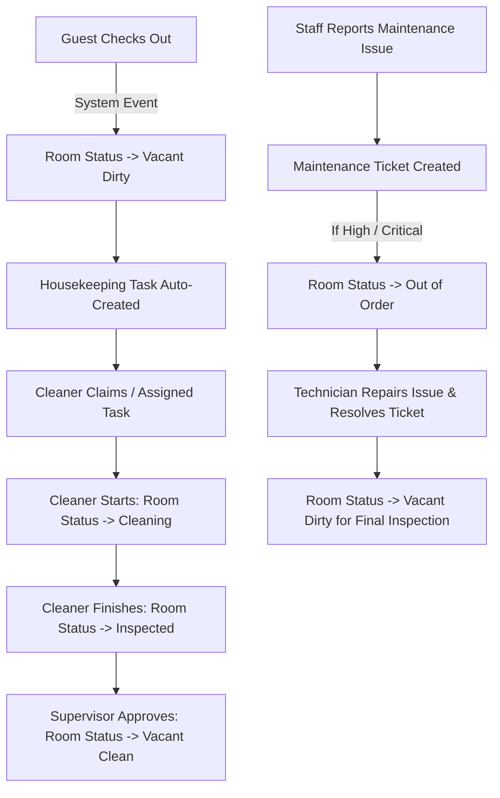

# Module 05: Housekeeping & Maintenance Operations

## 1. Overview & Objective
Housekeeping and maintenance ensure the hotel's physical inventory remains spotless, compliant, and operational. This module automates cleaning task dispatches following guest check-outs, coordinates routine stay-over cleanings, and tracks maintenance work orders (with automatic room blocking for repairs).

---

## 2. Housekeeping & Maintenance Workflow



---

## 3. Database Schema

### Table: `housekeeping_tasks`
```sql
CREATE TABLE `housekeeping_tasks` (
    `id` BIGINT UNSIGNED AUTO_INCREMENT PRIMARY KEY,
    `hotel_id` BIGINT UNSIGNED NOT NULL,
    `room_id` BIGINT UNSIGNED NOT NULL,
    `assigned_to_user_id` BIGINT UNSIGNED NULL,
    `task_type` ENUM('checkout_clean', 'stayover_clean', 'deep_clean', 'turndown') DEFAULT 'checkout_clean',
    `priority` ENUM('low', 'normal', 'urgent') DEFAULT 'normal',
    `status` ENUM('pending', 'in_progress', 'inspected', 'completed') DEFAULT 'pending',
    `started_at` TIMESTAMP NULL,
    `completed_at` TIMESTAMP NULL,
    `inspected_by_user_id` BIGINT UNSIGNED NULL,
    `cleaner_notes` TEXT NULL,
    `created_at` TIMESTAMP NULL,
    `updated_at` TIMESTAMP NULL,
    FOREIGN KEY (`hotel_id`) REFERENCES `hotels`(`id`) ON DELETE CASCADE,
    FOREIGN KEY (`room_id`) REFERENCES `rooms`(`id`) ON DELETE CASCADE,
    FOREIGN KEY (`assigned_to_user_id`) REFERENCES `users`(`id`) ON DELETE SET NULL,
    FOREIGN KEY (`inspected_by_user_id`) REFERENCES `users`(`id`) ON DELETE SET NULL
);
```

### Table: `maintenance_tickets`
```sql
CREATE TABLE `maintenance_tickets` (
    `id` BIGINT UNSIGNED AUTO_INCREMENT PRIMARY KEY,
    `hotel_id` BIGINT UNSIGNED NOT NULL,
    `room_id` BIGINT UNSIGNED NOT NULL,
    `reported_by_user_id` BIGINT UNSIGNED NOT NULL,
    `assigned_to_user_id` BIGINT UNSIGNED NULL,
    `issue_category` ENUM('plumbing', 'electrical', 'ac_hvac', 'furniture', 'appliance', 'structural', 'other') NOT NULL,
    `title` VARCHAR(255) NOT NULL,
    `description` TEXT NOT NULL,
    `priority` ENUM('low', 'medium', 'high', 'emergency') DEFAULT 'medium',
    `status` ENUM('open', 'in_progress', 'resolved', 'closed') DEFAULT 'open',
    `blocks_room` BOOLEAN DEFAULT TRUE,
    `estimated_repair_cost` DECIMAL(10, 2) DEFAULT 0.00,
    `resolved_at` TIMESTAMP NULL,
    `resolution_notes` TEXT NULL,
    `created_at` TIMESTAMP NULL,
    `updated_at` TIMESTAMP NULL,
    FOREIGN KEY (`hotel_id`) REFERENCES `hotels`(`id`) ON DELETE CASCADE,
    FOREIGN KEY (`room_id`) REFERENCES `rooms`(`id`) ON DELETE CASCADE,
    FOREIGN KEY (`reported_by_user_id`) REFERENCES `users`(`id`),
    FOREIGN KEY (`assigned_to_user_id`) REFERENCES `users`(`id`) ON DELETE SET NULL
);
```

---

## 4. Backend Implementation Specification

### Automation Listeners & Services:
* `App\Listeners\CreateHousekeepingTaskOnCheckout`:
  * Listens to `GuestCheckedOutEvent`.
  * Automatically creates a `checkout_clean` task with priority `urgent` if a new reservation arrives today, or `normal`.
* `App\Services\MaintenanceService`:
  * If ticket created with `blocks_room = true`, immediately updates `rooms.status` to `out_of_order`.
  * On resolution, triggers room status update to `vacant_dirty` so housekeeping can sanitize before guest occupancy.

### Key Endpoints:
* `GET /housekeeping/my-tasks`: Mobile-optimized endpoint for staff logged in on floor duties.
* `PATCH /housekeeping/tasks/{id}/status`: Updates task lifecycle (*Pending* $\rightarrow$ *In Progress* $\rightarrow$ *Inspected* $\rightarrow$ *Completed*).
* `POST /maintenance/tickets`: File repair ticket.
* `PATCH /maintenance/tickets/{id}/resolve`: Mark repaired with resolution summary.

---

## 5. Frontend (React + TypeScript) Specification

### Pages & Views:
* `resources/js/Pages/Housekeeping/StaffMobileView.tsx`:
  * Clean, touch-friendly mobile interface for room attendants.
  * Big action buttons: "Start Cleaning Room 204", "Finished Cleaning", "Report Broken Item".
* `resources/js/Pages/Housekeeping/SupervisorDashboard.tsx`:
  * Floor overview table showing rooms by cleanliness state.
  * Batch assign cleaner to entire floors (e.g. Floor 2 to Attendant Sarah).
  * Quick 1-click inspection approval.
* `resources/js/Pages/Maintenance/Index.tsx`:
  * Ticket board categorized by priority (Emergency, High, Medium, Low).
  * Modal to file new ticket directly from room view.

---

## 6. Developer Task Checklist

- [ ] **Task 5.1:** Create migrations for `housekeeping_tasks` and `maintenance_tickets`.
- [ ] **Task 5.2:** Create event listener `CreateHousekeepingTaskOnCheckout` to auto-dispatch tasks.
- [ ] **Task 5.3:** Build room blocking logic: when `blocks_room` is true on maintenance tickets, set room status to `out_of_order`.
- [ ] **Task 5.4:** Create mobile-responsive Room Attendant view (`resources/js/Pages/Housekeeping/StaffMobileView.tsx`).
- [ ] **Task 5.5:** Create Supervisor Floor Board with bulk task assignment per attendant.
- [ ] **Task 5.6:** Build Maintenance Ticket submission modal with photo attachment support and severity tags.
- [ ] **Task 5.7:** Write feature tests for automated task generation upon checkout and room unblocking upon ticket resolution.

---

## 7. QA Acceptance Criteria
1. When a guest checkout is completed, a new housekeeping task is generated within the same database transaction.
2. An open emergency maintenance ticket strictly blocks any front desk staff from assigning the room to incoming guests.
3. Once supervisor marks a task as `completed`, the room status automatically transitions to `vacant_clean`.
