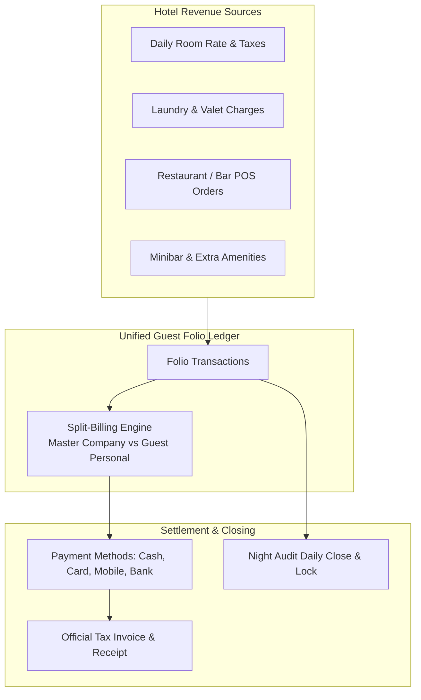

# Module 06: Billing, Guest Folios, POS & Automated Night Audit

## 1. Overview & Objective
Financial precision is vital in hospitality. This module unifies all room revenue, extra services (laundry, restaurant POS, minibar), deposits, taxes, and refunds into an immutable **Guest Folio Ledger**. It also includes the automated **Night Audit Engine** that posts daily room charges and balances hotel accounts at midnight.

---

## 2. Folio Architecture & Transaction Flow



---

## 3. Database Schema

### Table: `folios`
```sql
CREATE TABLE `folios` (
    `id` BIGINT UNSIGNED AUTO_INCREMENT PRIMARY KEY,
    `hotel_id` BIGINT UNSIGNED NOT NULL,
    `reservation_id` BIGINT UNSIGNED NOT NULL,
    `guest_id` BIGINT UNSIGNED NOT NULL,
    `folio_number` VARCHAR(30) NOT NULL UNIQUE, -- e.g. "FOL-2026-00891"
    `status` ENUM('open', 'settled', 'closed') DEFAULT 'open',
    `total_charges` DECIMAL(10, 2) DEFAULT 0.00,
    `total_payments` DECIMAL(10, 2) DEFAULT 0.00,
    `balance` DECIMAL(10, 2) DEFAULT 0.00,
    `currency` VARCHAR(10) DEFAULT 'USD',
    `created_at` TIMESTAMP NULL,
    `updated_at` TIMESTAMP NULL,
    FOREIGN KEY (`hotel_id`) REFERENCES `hotels`(`id`) ON DELETE CASCADE,
    FOREIGN KEY (`reservation_id`) REFERENCES `reservations`(`id`) ON DELETE RESTRICT,
    FOREIGN KEY (`guest_id`) REFERENCES `guests`(`id`) ON DELETE RESTRICT
);
```

### Table: `folio_transactions`
```sql
CREATE TABLE `folio_transactions` (
    `id` BIGINT UNSIGNED AUTO_INCREMENT PRIMARY KEY,
    `hotel_id` BIGINT UNSIGNED NOT NULL,
    `folio_id` BIGINT UNSIGNED NOT NULL,
    `user_id` BIGINT UNSIGNED NOT NULL, -- Staff/System user who posted
    `transaction_type` ENUM('room_charge', 'tax', 'laundry', 'restaurant_pos', 'minibar', 'fee', 'payment', 'refund') NOT NULL,
    `description` VARCHAR(255) NOT NULL,
    `amount` DECIMAL(10, 2) NOT NULL, -- Positive for charges, negative for payments/credits
    `reference_id` VARCHAR(100) NULL, -- Order ID, Payment Gateway Ref, Receipt #
    `payment_method` ENUM('cash', 'credit_card', 'debit_card', 'mobile_money', 'bank_transfer', 'complimentary', 'none') DEFAULT 'none',
    `is_night_audit_post` BOOLEAN DEFAULT FALSE,
    `is_immutable` BOOLEAN DEFAULT FALSE, -- Locked after night audit
    `posted_at` TIMESTAMP NOT NULL DEFAULT CURRENT_TIMESTAMP,
    `created_at` TIMESTAMP NULL,
    `updated_at` TIMESTAMP NULL,
    FOREIGN KEY (`hotel_id`) REFERENCES `hotels`(`id`) ON DELETE CASCADE,
    FOREIGN KEY (`folio_id`) REFERENCES `folios`(`id`) ON DELETE CASCADE,
    FOREIGN KEY (`user_id`) REFERENCES `users`(`id`)
);
```

### Table: `night_audit_logs`
```sql
CREATE TABLE `night_audit_logs` (
    `id` BIGINT UNSIGNED AUTO_INCREMENT PRIMARY KEY,
    `hotel_id` BIGINT UNSIGNED NOT NULL,
    `audit_date` DATE NOT NULL,
    `occupied_rooms_count` INT UNSIGNED NOT NULL,
    `total_room_revenue_posted` DECIMAL(12, 2) NOT NULL,
    `total_tax_posted` DECIMAL(12, 2) NOT NULL,
    `status` ENUM('in_progress', 'completed', 'failed') DEFAULT 'completed',
    `executed_by_user_id` BIGINT UNSIGNED NULL, -- Null if scheduled cron
    `notes` TEXT NULL,
    `created_at` TIMESTAMP NULL,
    `updated_at` TIMESTAMP NULL,
    FOREIGN KEY (`hotel_id`) REFERENCES `hotels`(`id`) ON DELETE CASCADE,
    UNIQUE KEY `hotel_audit_date_unique` (`hotel_id`, `audit_date`)
);
```

---

## 4. Backend Implementation Specification

### The Night Audit Engine (`app/Console/Commands/RunNightAudit.php`):
* Scheduled to trigger daily at midnight:
  ```php
  Schedule::command('hotel:night-audit')->dailyAt('00:01');
  ```
* Algorithm:
  1. Retrieve all active `checked_in` reservations for the hotel.
  2. For each reservation, post a `room_charge` transaction matching the agreed daily rate.
  3. Post associated tax transactions (e.g. 15% VAT).
  4. Recalculate `folios.total_charges` and `folios.balance`.
  5. Mark previous day's transactions as `is_immutable = true`.
  6. Log summary in `night_audit_logs`.

### Services & Controllers:
* `App\Services\FolioService`:
  * `addCharge(Folio $folio, string $type, float $amount, string $description, ?string $ref)`
  * `recordPayment(Folio $folio, float $amount, string $method, ?string $ref)`
  * `getSettlementSummary(Folio $folio)`
* `POSChargeController`: API endpoint `POST /pos/charge-to-room` allowing restaurant/bar to post food bills to occupied rooms.

---

## 5. Frontend (React + TypeScript) Specification

### Pages & Views:
* `resources/js/Pages/Billing/FolioDetail.tsx`:
  * Itemized chronological transaction table (Date, Type, Description, Charge, Credit, Staff).
  * Color-coded charges vs payments.
  * Action buttons: "Post Charge", "Record Payment", "Print Invoice", "Split Folio".
* `resources/js/Pages/Billing/PostChargeModal.tsx`:
  * Custom charge modal (Type: minibar/damage/extra service, amount, description).
* `resources/js/Pages/Billing/RecordPaymentModal.tsx`:
  * Select payment method (Cash, Visa/Mastercard, Mobile Money).
  * Auto-fills remaining balance.
* `resources/js/Pages/NightAudit/Index.tsx`:
  * Night audit history table with RevPAR and Daily Revenue totals.
  * Manual "Run Night Audit Now" emergency button with confirmation modal.

---

## 6. Developer Task Checklist

- [ ] **Task 6.1:** Create migrations for `folios`, `folio_transactions`, and `night_audit_logs`.
- [ ] **Task 6.2:** Build `Folio` and `FolioTransaction` models with balance recalculation hooks.
- [ ] **Task 6.3:** Implement `FolioService` ensuring atomicity (DB transactions) on charge/payment postings.
- [ ] **Task 6.4:** Build Artisan console command `hotel:night-audit` with comprehensive test coverage for midnight postings.
- [ ] **Task 6.5:** Create POS room-charge lookup endpoint (`GET /pos/active-rooms` and `POST /pos/charge-to-room`).
- [ ] **Task 6.6:** Build React Folio Management view with live balance ticker and transaction log.
- [ ] **Task 6.7:** Build Printable Tax Invoice view / PDF generator (with hotel logo, tax breakdown, guest details).
- [ ] **Task 6.8:** Write feature tests for split payment settlements and immutable transaction locking after night audit.

---

## 7. QA Acceptance Criteria
1. Folio balance must always equal `total_charges - total_payments` with zero floating-point rounding errors.
2. A guest checkout cannot be finalized if `balance > 0` unless specifically authorized by a Manager role.
3. The Night Audit command is idempotent: running it twice for the same calendar date will not double-charge guests.
